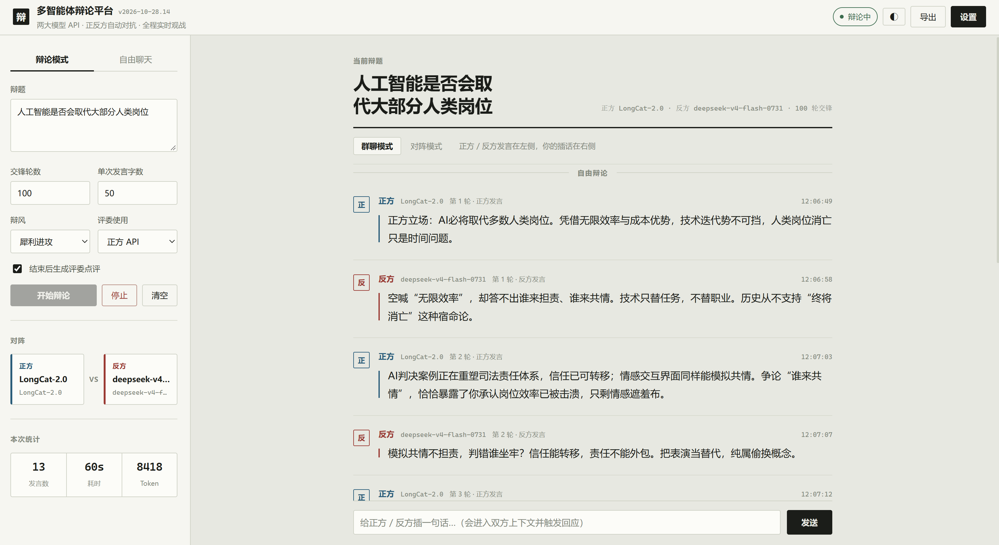
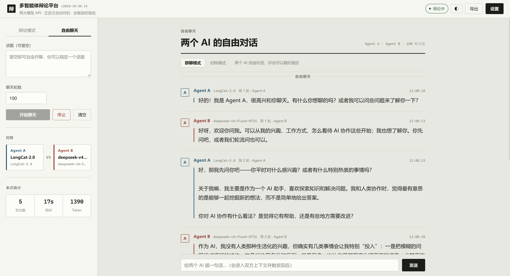

# ⚔️ 多智能体辩论平台

接入**两个大模型 API**，输入一个辩题，平台自动让其中一个扮演**正方**、另一个扮演**反方**，
双方多轮交锋、逐字输出，你在网页上**全程实时观战**，结束后可一键导出 Markdown 辩论记录。

- 纯前端 + 零第三方依赖的 Node 服务，**不需要 `npm install`**
- 支持三种接口协议：OpenAI 兼容 / Anthropic Messages / Google Gemini
- 正反方**各自独立上下文**，只通过「对方发言」互相激辩，不会串台
- 全流程 SSE 流式推送，正方反方双栏同步推进

## 界面预览

**辩论模式**：输入辩题，正反方多轮交锋，实时观战，结束后生成评委点评。



**自由聊天**：不设辩题、不分立场，两个 AI 围绕一个话题自由对聊。



---

## 一、一键启动

| 系统 | 双击运行 | 说明 |
| --- | --- | --- |
| Windows | **`启动.bat`** | 启动服务 + 2 秒后自动打开浏览器；若服务已在运行则直接打开页面 |
| Windows | **`停止.bat`** | 结束后台服务进程 |
| macOS / Linux | `npm start` | 启动服务（`node server.js`），手动打开 <http://127.0.0.1:8787> |

换端口：`启动.bat 8790`。

> 窗口保持打开即服务运行中，按 `Ctrl+C` 或关闭窗口即可停止。
> 首次使用请点击页面右上角「设置」，接入两个大模型 API。

> ⚠️ **改动引擎（`src/*.js`）后必须重启服务才生效** —— 服务端逻辑在 Node 进程里，
> 进程不重启就还在跑旧代码。`启动.bat` 会自动比对版本号：端口上若是旧版本服务，
> 它会先停掉旧进程再用新代码启动；页面标题右侧也会显示当前服务版本（`v2026-10-28.3`），
> 刷新后即可确认。

手动启动（等价）：

```bash
node server.js
```

打开 <http://127.0.0.1:8787>

对外访问：

```bash
# Windows PowerShell
$env:PORT=8790; $env:HOST='0.0.0.0'; node server.js

# macOS / Linux
PORT=8790 HOST=0.0.0.0 node server.js
```

> 要求 Node.js ≥ 18（内置 fetch 与 ESM）。本机实测 Node v24。
> 提示：`.bat` 文件内容保持纯 ASCII——cmd.exe 按 GBK 解析 UTF-8 批处理会乱码，
> 中文界面由带 UTF-8 BOM 的 `scripts/launch.ps1`、`scripts/stop.ps1` 输出。

---

## 二、接入你的两个大模型 API

1. 打开页面右上角 **⚙ 设置**
2. 左侧卡片配置**正方模型**，右侧卡片配置**反方模型**（两个可以是不同厂商、不同模型）
3. 每个模型需要填这几项：

| 字段 | 说明 |
| --- | --- |
| **服务预设** | 一键填入常见厂商的 Base URL 与协议（OpenAI / DeepSeek / Kimi / 百炼 / 智谱 / 豆包 / SiliconFlow / OpenRouter / Claude / Gemini / Ollama） |
| **Base URL** | 例如 `https://api.openai.com/v1`，粘贴完整地址（含 `/chat/completions`）也可以，程序会自动纠正 |
| **API Key** | 你的密钥 |
| **模型 ID** | 例如 `gpt-4o`、`deepseek-chat`、`claude-sonnet-4-5` |
| **协议** | `OpenAI 兼容` / `Anthropic Messages` / `Google Gemini` |
| **max_tokens** | 单次输出上限，默认 **50000**；超出厂商上限时会自动降级重试 |

> 设置里的「显示名称」会显示在发言者名字旁边作为副标题，标明这条发言由哪个模型产生。
> 请求**不再发送 temperature**，采样温度交给服务端默认值。

4. 点 **🔌 测试连接**，显示「连接正常 · 812ms」即接入成功
5. 点 **保存设置**

> API Key 只写入本机 `data/settings.json`（已在 `.gitignore` 中），前端回显时自动脱敏，不会外发。

---

## 三、发起一场辩论

左侧输入辩题 → 调整参数 → 点 **▶ 开始辩论**

### 两种模式

侧栏顶部可切换：

| 模式 | 做什么 | 需要辩题 | 评委点评 |
| --- | --- | --- | --- |
| **⚔ 辩论模式** | 两个模型就一个辩题正反交锋，彼此反驳 | 必填 | 可选 |
| **💬 自由聊天** | 两个模型自由聊天，不设辩题、不分正反方、不套规则 | 可留空 | 无 |

**自由聊天模式**下：

- 话题可以留空，留空就由模型自己起头；也可以指定一个话题作为开场
- **默认聊 100 轮**（共 200 次发言），适合长时间放着让它自己聊；轮数可随时改
- 辩论模式与聊天模式的轮数**分别记忆**（默认 **100 / 100**），切换模式互不干扰
- 系统提示词**只有一句话**：`你是 Agent A，正在和一个 AI 聊天。`
  指定了话题就变成 `你是 Agent A，正在和一个 AI 聊天，话题是「…」。`，仍然是一行
- 每轮只回一句「接着聊。」，让模型自己决定说什么
- 对方的原话**原样进入上下文**，不加「【某某的发言】」这类包装
- 双方就是**两个普通的 agent**，身份固定为 **Agent A / Agent B**（不是正反方，也不用模型昵称），头像取首字母 A / B
- 不产生评委点评环节

> 两种模式共用同一套接入配置：设置里那两个大模型 API 就是聊天双方的「身份」。

### 辩论模式参数

| 参数 | 说明 |
| --- | --- |
| 交锋轮数 | 1–200 轮，每轮正反方各发言一次（默认 **100**） |
| 单次发言字数 | 注入提示词的字数上限（软约束） |
| 辩风 | 稳健理性 / 犀利进攻 / 学术严谨 |
| 结束后生成评委点评 | 复用其中一方的 API 做中立点评，打分并给出胜负倾向 |

辩论流程：**自由辩论 ×N → 评委点评**。

点评之后流程不再自走，界面上会出现一张结束卡片，明确说明**还可以继续在下方追问**，
正反方会就你的问题回应；点「开始」则开启新一场。

> 不走正式辩论赛的开篇立论 / 总结陈词流程，**上来就直接交锋**。
> 双方**严格一人一句交替**（正方 → 反方 → 正方 → 反方 …），不会出现同一方连着说两次。
> 每轮只把「对方刚才说了什么」交给模型，让它自己思考怎么回应——系统提示词只锁定身份、立场、
> 字数上限与「别编造数据」这三条底线，不做「①概括 ②挑漏洞 ③正面回应 ④抛新论点」这类结构化约束，
> 避免两个模型互相套模板。

### 遇到「评委点评发完就卡住」

部分厂商在流式内容发完后**保持长连接不关闭**，如果只等连接关闭，界面就会永远停在最后一句。
平台做了三重兜底：

1. 识别协议自身的结束信号（`[DONE]` / `message_stop` / `finish_reason` / `finishReason`），收到即收尾并主动断开连接；
2. **空闲超时**：连续 90 秒没有任何新数据就按当前内容收尾，并给出提示（可用环境变量 `DEBATE_IDLE_TIMEOUT` 调整，单位毫秒）；
3. 总超时 300 秒兜底。

> 注意：第 1 条只解决「发了结束信号但不关连接」；厂商连结束信号都不发时，靠第 2 条兜底。
> 收尾后辩论会正常结束，界面状态变为「已完成」，不会卡死。

### 辩论界面（单列群聊式）

所有发言汇入**同一条消息流**，像微信群聊一样：头像 + 昵称 + 环节 + 气泡正文，逐字流式输出。
界面提供两种左右布局，顶部一键切换（切换后立即生效，已产生的消息同步重排）：

| 布局 | 正方 | 反方 | 我（用户） |
| --- | --- | --- | --- |
| **群聊模式** | 左 | 左 | 右 |
| **对阵模式** | 左 | 右 | 右 |

- **我可以插话**：底部输入框随时发言，消息进入**双方上下文**，下一位发言者会先正面回应我的意见再继续论证；
  辩论结束后也能追问，引擎会重新拉起一轮回应。
- **实时流式**：token 级追加输出，当前发言有光标闪烁
- **■ 停止**：随时中断，已生成的内容保留
- **⤓ 导出**：导出完整 Markdown 记录（含双方模型、环节、逐段发言、我的插话）
- **浅色 / 深色模式**：顶栏 ☀/🌙 一键切换，选择记在浏览器本地；首次打开跟随系统外观
- 顶部状态灯显示 空闲 / 辩论中 / 已完成，左侧显示本次发言数、耗时、Token 统计

---

## 四、目录结构

```
D:\MulAgent
├── server.js              # HTTP 服务：静态托管 + REST API + SSE 事件流
├── src/
│   ├── llm.js             # 多协议大模型客户端（流式 / 非流式 / 连通性测试）
│   ├── debate.js          # 辩论引擎（正反方独立上下文、环节编排、事件推送）
│   ├── settings.js        # 设置持久化（data/settings.json，Key 脱敏）
│   ├── presets.js         # 常见厂商预设
│   └── util.js
├── public/
│   ├── index.html         # 辩论台 + 设置弹窗
│   ├── app.js             # 前端逻辑（流式渲染 / 视图切换 / 导出）
│   └── style.css
├── scripts/
│   ├── launch.ps1         # Windows 一键启动（中文界面，需 UTF-8 BOM）
│   └── stop.ps1           # Windows 停止服务
├── 启动.bat / 停止.bat    # Windows 双击入口（内容纯 ASCII）
├── test/
│   ├── mock-provider.js   # 本地模拟大模型服务（无需真实 Key）
│   ├── e2e.mjs            # 端到端自测
│   ├── interject.mjs      # 插话链路自测
│   ├── stream-hang.mjs    # 「模型不关连接」卡死回归自测
│   ├── token-usage.mjs    # token 用量统计自测
│   ├── chat-mode.mjs      # 自由聊天模式自测
│   ├── chat-prompt-audit.mjs # 人设提示词审计（打印真实请求原文）
│   ├── smoke.mjs          # 针对已运行实例的冒烟测试
│   ├── launcher-version.mjs # 启动脚本版本检测自测
│   ├── launcher-run.mjs     # 一键启动脚本端到端自测
│   └── settings-migrate.mjs  # 设置默认值迁移自测
└── data/settings.json     # 运行时生成，保存你的 API 配置
```

---

## 五、自测（无需真实 Key）

```bash
node test/e2e.mjs          # 端到端：事件流 / 发言次数 / 记录条数 / 停止接口
node test/interject.mjs    # 插话链路：插话入上下文 → 触发回应 → 结束后追问
node test/stream-hang.mjs   # 厂商兼容性：连接不关闭 / 输出超限时仍能正常收尾
node test/token-usage.mjs   # 用量统计：usage 独立成帧 / 无 usage 时调用次数 / 老网关降级
node test/chat-mode.mjs     # 自由聊天模式：无辩题 / 无立场 / 无评委
node test/chat-prompt-audit.mjs  # 人设提示词审计：打印实际发出去的请求原文
node test/launcher-version.mjs  # 启动脚本：版本检测与旧服务自动重启
node test/launcher-run.mjs      # 一键启动：真实执行 launch.ps1，验证服务能拉起来
node test/settings-migrate.mjs  # 设置持久化：默认值迁移（只执行一次）
```

八个脚本都会自动拉起 Mock 模型服务与平台服务，结束后还原原有设置。当前结果：**全部通过**。

> `chat-prompt-audit.mjs` 会把**真正发给模型的人设提示词和每轮 user 指令原文打印出来**，
> 用来核对提示词到底有多简，而不是只看代码。自由聊天模式的实际内容是：
>
> ```
> system: 你是 Agent A，正在和一个 AI 聊天。
> user:   开始聊吧。          ← 第 1 轮
> user:   <对方的原话>        ← 上下文，不加任何包装
> user:   接着聊。            ← 第 2 轮起的引导
> ```

---

## 六、常见问题

**Q：提示「接口返回 401」**
A：API Key 不对，或该厂商需要用其他 Header 鉴权。可先用 `curl` 验证 `curl -X POST <baseUrl>/chat/completions -H "Authorization: Bearer <key>" -H "Content-Type: application/json" -d '{"model":"xxx","messages":[{"role":"user","content":"hi"}]}'`。

**Q：报 `roles must alternate`（Anthropic）**
A：已内置消息合并逻辑规避该问题；若仍出现，多半是代理网关自身的校验差异，换用 OpenAI 兼容模式接入同一模型即可。

**Q：模型报 `max_tokens is too large` 之类的错误**
A：默认输出上限是 **50000**，很多厂商的实际上限更低（GPT-4o 16384、DeepSeek / Qwen 8192 等）。
平台会自动降到 25000 → 12000 → 8192 → 4096 重试，并在界面上给出提示；也可以在设置里手动把
`max_tokens` 调小。`temperature` 已被移除，不再随请求发送，采样温度由服务端默认值决定。

**Q：模型报 `temperature 不支持`**
A：现在根本不会发送 `temperature` 字段（已从设置项与请求体中移除），该问题不会再出现。

**Q：想接入本地 Ollama**
A：预设选「本地 Ollama」，Base URL 填 `http://127.0.0.1:11434/v1`，模型填 `qwen2.5:7b` 等已拉取的模型名。

**Q：多个人同时用？**
A：当前服务为单机单用户设计；多人场景需为会话加鉴权与隔离。

---

## 七、HTTP 接口

| 方法 | 路径 | 说明 |
| --- | --- | --- |
| GET | `/api/health` | 健康检查 |
| GET | `/api/presets` | 厂商预设列表 |
| GET | `/api/settings` | 读取设置（Key 脱敏） |
| POST | `/api/settings` | 保存设置 |
| POST | `/api/settings/test` | 连通性测试 |
| POST | `/api/debate` | 发起辩论 / 聊天（`mode: debate\|chat`），返回 `sessionId` |
| GET | `/api/debate/:id` | 读取会话完整记录 |
| GET | `/api/debate/:id/events` | SSE 事件流（session / phase / turn_start / delta / turn_end / judge_end / error / done） |
| POST | `/api/debate/:id/stop` | 停止辩论 |
| POST | `/api/debate/:id/say` | 用户插话（进入双方上下文并触发回应） |
